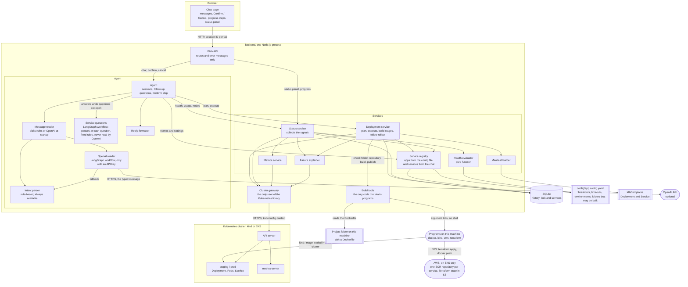
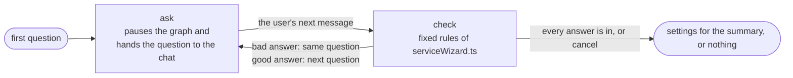

# Design

**What changed since the first version.** The first version deployed images that someone else had built, and the list of apps was fixed in the config file. The assistant can now also create a service from a project folder on the user's machine, change its settings and rebuild it. For that it builds images itself and, on EKS, runs Terraform. Sections 1, 2, 3, 4, 9 and 10, Terraform answers 1 and 5, the new part after answer 5 and the list of limits were rewritten for this. Section 4 says which earlier guarantees no longer hold.

## 1. Architecture

Each layer calls only the layer below it. The browser never talks to Kubernetes. The routes contain no logic. One folder, `src/cluster/`, is the only place that imports the Kubernetes client library; the services see a small interface (`ClusterGateway`, in `src/types/cluster.ts`) with plain data types.

That one boundary pays for itself twice. The unit tests swap the gateway for an in-memory fake and run without a cluster, and a different cluster is just a different gateway.

**The build boundary.** Creating a service from a project folder means starting programs. That power sits behind a second boundary of the same kind, the folder `src/build/`:

| File | What it does |
|---|---|
| `commandRunner.ts` | Starts a program. It is the only file in `src/` that imports `node:child_process`. It accepts four program names (`docker`, `kind`, `aws`, `terraform`), takes the arguments as a list and uses no shell |
| `clusterTarget.ts` | Reads the cluster's name from the kubeconfig and decides what it is: `kind-<name>` is a kind cluster, an EKS ARN is an EKS cluster, anything else is "other" |
| `imageBuilder.ts` | The build and publish commands, one set for kind and one for EKS |
| `serviceInfra.ts` | The Terraform run that creates a service's image repository on AWS |
| `buildTools.ts` | Picks the right set for the cluster. For "other" it returns no builder, and the chat then refuses to create a service |
| `projectFolder.ts` | Checks a folder the user named. It starts no program; it reads the folder and its Dockerfile |

The Deployment service sees only two small interfaces from `src/types/build.ts`: `ImageBuilder` (build, publish) and `ServiceInfra` (ensure). The unit tests hand it pretend ones, so no test starts Docker or Terraform. The folder check is the one exception: the Deployment service calls it directly, because it only reads the disk.

**The service registry.** `ServiceRegistry` (`src/services/serviceRegistry.ts`) answers "which services exist, and with which settings". It reads two places: the `apps:` section of the config file, whose apps exist in every environment, and a `services` table in the same SQLite file as the history, with one row per cluster, environment and name. The intent parser, the OpenAI reader and the status panel ask the registry every time they need the names, so a service created a moment ago is known without a restart. `sample-app` is still a config app, so every earlier command works as before.

Reading a chat message has the same kind of boundary. The Agent asks a message reader, and gets the same small request back whether the rules or OpenAI read the message. LangGraph is used in two files: `src/agent/openAiReader.ts` for reading a message with OpenAI, and `src/agent/serviceFlow.ts` for the service questions. The OpenAI library is used in one file (`src/agent/openAiModel.ts`). Section 10 explains the two readers and the question workflow.

The questions that create or edit a service are a separate piece of the Agent layer, in two files. `src/agent/serviceWizard.ts` holds the questions and the rule for each answer, as pure functions. `src/agent/serviceFlow.ts` runs them as a LangGraph workflow that pauses at each question and continues with the user's answer (section 10). They read no file and call no cluster. What they need from outside (the environments, the default values, "is this name taken", "check this folder") is handed in, so the same answers always give the same result. While the questions are open, the message reader is not used at all (section 10).

**Trade-offs.**

- The gateway translates every Kubernetes object into a smaller type of my own. That is extra code, and a field I did not map is not available to the services until I add it. I accepted that because the services stay readable and testable.
- The kind of cluster is worked out from its name in the kubeconfig, so there is no extra setting to get wrong. The price: a cluster whose kubeconfig entry was renamed by hand is seen as "other", and the assistant then refuses to build for it.

## 2. Long operations

A rollout can take minutes, and building an image can take longer, so the Confirm request waits for neither.

**A change without a build** (deploy a named version, scale, roll back, edit a setting):

1. `execute()` takes the lock, applies the manifests and returns an operation ID. This takes well under a second.
2. A loop keeps running in the background of the same Node.js process. Every 2 seconds it reads the Deployment and its pods and records progress such as `2/3 pods ready`.
3. The browser asks `GET /api/operations/:id` once a second and redraws the progress: the step the change is at (for example "Starting the pods, 2 of 3 ready") and a track with one square per pod, from "sent" to "finished".

**A change with a build** (`create a service`, or `deploy <name> to <env>` without a version for a service that has a project folder):

1. Confirm checks that the environment is free and that the cluster still matches the summary. Then it inserts the history row, which takes the environment's lock, saves the service's settings in the registry, and returns an operation ID. Nothing has been built yet (`startBuild` in `src/services/deploymentService.ts`).
2. The work goes on in the background, in stages. The operation records which stages it has (`stages`) and which one is running (`stage`).
3. The browser asks once a second as before. The progress track shows one step per stage, and the pods only in the last one.

| Stage | On kind | On EKS |
|---|---|---|
| `repository` | not needed | Checks that the AWS login belongs to the cluster's account. Then `terraform init` and `terraform apply` on `terraform/service/`, which creates the ECR repository `<cluster>/<service>` or finds nothing to change |
| `build` | `docker build` from the project folder | The same with `--platform linux/amd64`, because the cluster's machines are x86 |
| `publish` | `kind load docker-image` copies the image into the cluster's node | `aws ecr get-login-password`, `docker login` with the password on standard input, `docker push` |
| `pods` | Applies the Service and the Deployment, then the same rollout loop as above | The same |

**When a stage fails.** The operation ends as failed and names the stage: `Deployment dep-007 failed while building the image: "docker build" failed: <the last line the program printed> Fix it, then type "deploy orders-api to staging" to try again.` The history row is marked failed, which releases the lock. A failure before the `pods` stage leaves the Deployment and the Service untouched; at most an image, and on EKS the repository, is left behind. The saved settings are kept, so the retry is one message and not ten answers again.

**Version numbers.** The assistant numbers the images it builds: `v1`, `v2` and so on. The next number is one more than the highest number saved for that service name in any environment of the cluster, because the environments of one cluster share one image repository. A number that went to a failed build is not used again. `deploy <name> version v2 to <env>` still deploys an existing image without building.

Node.js stays responsive because every Kubernetes call is asynchronous and every program runs as a separate process: while one rollout or one build waits, the Node.js process serves other requests.

**Why polling.** It is the simplest of the three options and works through any proxy. The progress is a few short strings, so a request per second costs almost nothing. The price is a delay of up to one second and some wasted requests. Server-Sent Events would push each step as it happens and is what I would move to with many users. WebSockets are for two-way traffic, which this does not need.

**Trade-off: the settings are saved before the build.** That is what makes the one-message retry possible. The price is that a service whose first build failed is already in the registry. The status panel shows it as NOT DEPLOYED, and there is no command to delete a service.

**Limit.** Progress lives in memory. If the backend restarts during a rollout, Kubernetes finishes the rollout anyway, but nobody is watching it. On the next start those history rows are marked `interrupted`, which also frees the environment's lock. A build that was running is not resumed either; the retry is the same `deploy <name> to <env>`. What a Terraform run that was cut off half-way leaves behind has not been tested.

## 3. Two confirmations at the same moment

**In Kubernetes, with no protection.** Both updates are accepted one after the other. The Deployment controller starts rolling out the first image, then turns around and rolls out the second. The last write wins, and the first user believes their version is live.

**What the app does.** Three layers, strongest first:

1. **A lock in the database.** Starting a change inserts a row with status `in_progress`. A unique index allows one such row per environment of a cluster, so when two requests arrive together the database accepts exactly one. The other user reads: `staging already has a deployment in progress (dep-006, started by asha). Try again when it finishes.`
2. **A stale-summary check.** Before applying, the app compares the cluster with what the user saw in the confirmation. If someone else changed the environment in between, it refuses and asks them to ask again.
3. **The resource version.** A replace carries the version that was read. If the Deployment changed in between, Kubernetes answers 409 Conflict instead of overwriting.

**Trade-offs.** The lock is per environment, not per app, which is stricter than needed once there are many apps. It also lives in one SQLite file, so it only works with one backend instance. With several instances I would move it to a shared database or a Kubernetes Lease.

**A build holds the lock much longer.** The lock is taken at Confirm and released when the rollout ends, so a build keeps it for minutes where a deploy kept it for seconds. Until then every other change to that environment is refused, also for other services. Every program the build starts has a timeout (`build.timeoutSeconds` in the config file, 900 by default), so the lock always comes back. In the worst case that is after several such timeouts in a row, because one build is several commands. A lock per service would fix this and is the next step.

**One gap the lock does not close.** The version number is picked when the summary is shown, not at Confirm. If the same service has a summary open in staging and in prod at the same moment, both can show the same number, and the two builds would then use the same image name. One user working alone does not hit this. Picking the number at Confirm would close it.

## 4. Security

**How the backend authenticates to EKS.**

- **kubeconfig** says where the cluster is and how to get a credential. For EKS it does not hold a password; it runs `aws eks get-token`.
- **AWS IAM** answers "who is calling". The token is a request signed with the assistant's IAM role, and EKS asks AWS to verify it.
- **An EKS access entry** maps that IAM role to a Kubernetes group, `deployment-assistant`.
- **Kubernetes RBAC** answers "what may they do". A RoleBinding in `staging` and `prod` gives the group a Role.

**The minimum Role**, in each of the two namespaces:

| Resource | Verbs | Used for |
|---|---|---|
| deployments | get, create, update | deploy, scale, roll back, create a service, edit its settings |
| services | get, create, update | the Service in front of the pods |
| services/proxy | get | the health check call (`/health`, or the path a service was given) |
| pods | list | pod states and restart counts |
| pods/log | get | last log lines of a crashing pod |
| events | list | why a pod is not ready |
| namespaces | get | telling "namespace missing" from "not deployed" |
| pods in `metrics.k8s.io` | list | CPU and memory |

Plus one read-only ClusterRole to list nodes and their usage, because nodes belong to no namespace. I tested these exact rules on kind with a restricted login: deploy, roll back, scale, health, logs, CPU and memory, and nodes all worked, and delete, Secrets and other namespaces were refused.

Creating, editing and rebuilding a service needed no new rule. They make the same two calls as a deploy: create or replace a Deployment and a Service. The Role and the files that define it are unchanged. The test with the restricted login was done before these three existed and has not been repeated for them.

**What changed in the security model.** Before this change, two things were true that a reviewer could rely on:

1. The backend's own code started no program. It only made Kubernetes API calls.
2. Every app had to be in the config file. A chat user could not add one.

Neither holds now. The assistant builds images, so it starts programs, and a service can be created from the chat. This is what replaced the two guarantees:

| What the assistant can do now | What limits it |
|---|---|
| Start programs | One file may do it (`src/build/commandRunner.ts`). It accepts four program names: `docker`, `kind`, `aws`, `terraform`. The name is checked when the command runs, not only by the type system. The arguments are passed as a list and no shell reads them, so a space or `$(...)` in a folder name is plain text. Every command has a timeout. What a program prints goes to the server log. A password is handed over on standard input, never as an argument, and is not logged |
| Read and build a folder on the user's machine | The folder must be a full path inside one of `build.allowedRoots` in the config file (the default is the home folder). Links and `..` are resolved first, so a link that points outside is refused. The allowed folder itself is refused. The folder must contain a `Dockerfile`. The assistant reads that one file, to suggest the port |
| Add a service that is not in the config file | Each answer is checked by a fixed rule: a name of lowercase letters, digits and single dashes, at most 40 characters; a port from 1024 to 65535; the health path pattern; CPU and memory amounts (memory under 8Mi and CPU over 16 cores are refused, which catches a number typed without a unit); at most 50 replicas; at most 20 variables. The manifest builder checks the name, the port, the amounts, the health path and the variable names again. Variables are set on the finished Deployment object and never pasted into the template text |
| Create something on AWS | Only by running the small stack in `terraform/service/`, which holds one ECR repository. It has a state file of its own per service. Before it runs, the assistant checks that the AWS login belongs to the cluster's account. The cluster stack is not touched (see the Terraform part) |
| All of the above | Nothing is built, created or changed before the user clicks Confirm on a summary that shows the folder, the image name and every setting |

Two pieces of typed text end up in a command line. The folder arrives as the full path the file system gave back, so it starts with `/` and cannot be taken for an option. The service name starts with a letter and has only lowercase letters, digits and single dashes. Variables never reach a command line; they go to the cluster through the Kubernetes API.

One more program is started, as before, by the Kubernetes client library and not by my code: the login command the kubeconfig names. For EKS that is `aws eks get-token`.

**What does not limit it.** These are the honest gaps:

- **A Dockerfile is a program.** `docker build` runs what the Dockerfile says, on the user's machine, through the user's Docker. The assistant does not read it for safety, check it or sandbox it. The folder check decides which folders may be built; it is not a sandbox. The default allowed folder is the whole home folder, which is wide.
- **The AWS side is not least privilege yet.** See "Two logins on EKS" below.
- **Variables are plain text.** They are stored in the SQLite file, written into the Deployment and shown in the summary and in the chat. There is no support for Kubernetes Secrets. The question says not to put passwords there; nothing enforces it.
- **The programs inherit the assistant's environment variables.** That is how they find `PATH`, Docker and the AWS login. It includes `OPENAI_API_KEY` when one is set. Docker does not pass its own environment on to the steps of a Dockerfile, but handing each program only the variables it needs would be the tidier design.
- **`docker login` keeps the registry password.** On EKS, Docker stores the 12-hour ECR password in the user's Docker settings, as it does when the command is typed by hand.

Because of the first point, the assistant is a local tool for the person who runs it. It is not a shared service: whoever can type in the chat can make the machine build a folder under the allowed root.

**Two logins on EKS.**

| Work | Login used | How narrow |
|---|---|---|
| Everything in Kubernetes: Deployments, Services, health, metrics | The assistant's IAM role, through the `eks-assistant` kubeconfig context | Narrow, and unchanged: the Role above, in two namespaces. On AWS the role can only describe the cluster |
| The image repository (Terraform) and the image upload | The AWS profile named in `AWS_BUILD_PROFILE`. When that is empty, the AWS login of the terminal the assistant was started in | Not narrow. Today this is the operator's own login, with whatever rights that person has |

A dedicated "builder" role is the next step, and it is not built. It would need to read and write state files under `deployment-assistant/services/` in the state bucket, to create and describe ECR repositories named `<cluster>/*`, and to push images to them. It would not need to delete a repository. [terraform/README.md](terraform/README.md) lists the actions for the Terraform run. Until that role exists, a bug in the build code runs with the operator's AWS rights, limited only by what the code itself does: one fixed stack, one repository name built from the cluster and the service.

**Stopping a browser user from doing what they should not.**

- The browser can send only two things: a line of text, and the ID of an action the server created for that tab. It cannot name a Kubernetes operation, a program or an argument.
- A change runs only through `confirm()`, with an ID that is bound to one session, works once and expires after ten minutes.
- Every value is checked on the server: the environment must be in the config file, the service must be in the registry (a config app, or one created from the chat), the image version must match a strict pattern, and replicas have a maximum.
- While the questions for a service are open, a message is only ever an answer. A different request typed in the middle, such as a deploy, is not carried out; the chat says so and repeats the question.
- When OpenAI reads the message, its answer is treated like the user's text: a proposal that goes through the same checks and the same Confirm step (section 10).
- The server listens on `127.0.0.1` only. Every request that can change something needs a custom header, so another website open in the same browser cannot make the browser send one.
- The server also refuses any request whose `Host` header is not `127.0.0.1`, `localhost` or `[::1]` (`src/api/routes.ts`). This is for one known trick: a website can point its own domain name at `127.0.0.1`, and the browser then treats the assistant as part of that website. Such a request still carries the website's name in its `Host` header, so it is refused before anything is read. I added this check because the assistant can now build and deploy.
- Whatever goes wrong in the Kubernetes calls, RBAC still limits them to two namespaces. The programs on the user's machine and the AWS login have no such outer limit today.

**What is missing.** There is no login. The name in the top right corner is typed by the user and is not proof of who they are. For a shared installation I would add single sign-on and a rule such as "only release managers may confirm a change to prod". Before anyone but the operator may use it, I would also add the builder role, run the build in a place that is not the operator's own machine, and store secret values as Kubernetes Secrets.

## 5. The rollout completes but /health fails

**For rolling back automatically.** Recovery is fast and needs nobody awake. The previous version is known to have worked.

**Against.** A failing `/health` does not prove the new version is at fault: a database or another service may be down, and then rolling back changes nothing but hides the evidence. If the new version already changed a database schema, the old version may be worse. And a tool that changes production by itself, without being asked, is harder to trust.

**What I chose: no automatic rollback.** The assistant reports DOWN with the reason, and the user types `roll back staging` and confirms. That is one message and one click, with a person making the decision.

Two things make this safer than it sounds. The readiness probe also calls `/health`, so a version that fails it never becomes ready and the rollout does not complete. And the rollout uses `maxUnavailable: 0`, so the old pods keep serving until new ones are ready. I saw this with the broken `v3` image: the rollout failed and the app stayed up.

Automatic rollback is a reasonable opt-in for staging later. I would not make it the default for prod.

## 6. "What was CPU usage during the spike an hour ago?"

The metrics API holds only the latest value, so this needs something that stores history.

- **Prometheus** scrapes every container every few seconds and keeps the series. The question becomes one range query. Trade-off: one more system to run, secure and give storage.
- **CloudWatch Container Insights** on EKS does the same as a managed service. Trade-off: cost per metric, and it works only on AWS.

In the code this would be one more gateway method for a range query and one more intent. I would not record samples in SQLite myself: that is building a small, worse Prometheus.

## 7. Thresholds

| Threshold | Value | Why |
|---|---|---|
| Memory | 85% of limit | Memory cannot be slowed down. At 100% the container is killed, so the warning needs room. |
| CPU | 90% of limit | At the limit CPU is throttled, not killed, so the warning can come later. |
| Restarts | more than 3 | One restart can be bad luck. Several are a pattern. |
| Recent OOMKill | within 30 minutes | Long enough to notice, short enough to clear by itself. |
| `/health` response | slower than 1000 ms | A health check should answer in milliseconds. |
| Pending | longer than 60 seconds | Normal scheduling and image pulls finish well inside that. |

These are sensible starting points, not measured values. A real team would tune them against its own traffic.

**Per team.** The config file has `thresholds.overrides.<environment>`, so `prod` can be stricter than `staging` without touching code. To let each team set its own without a central file, I would read them from annotations on the team's Deployment or from a ConfigMap in its namespace.

## 8. 200 pods across 20 namespaces

**Fast.** Already in place: one LIST of pods and one LIST of metrics per app, never one call per pod; the health call and the metrics call run at the same time; only the first five failing pods are explained, because each explanation can cost two more calls.

What I would add: check namespaces in parallel with a limit on how many run at once; keep results for a few seconds so several users asking the same thing cost one round of calls; and for a busy installation, switch from asking on demand to watching, which keeps a local copy of the pods up to date.

**Readable.** Nobody reads 200 lines in a chat. Lead with one summary line, such as "20 environments: 17 healthy, 2 degraded, 1 down". Show details only for the ones that are not healthy, limit pod lists to the worst few with "and 12 more", and let the user ask for one environment in full.

## 9. A second cluster, or GKE

The agent and services depend on the `ClusterGateway` interface, not on a cluster.

- **GKE** speaks the same Kubernetes API. It is one more kubeconfig context, with Google's login plugin in place of `aws eks get-token`. Deploying a named version, scaling, rolling back, health and usage need no code changes.
- **Building is the part that is not portable yet.** Where a built image has to go is different for every kind of cluster, and the assistant knows two: kind and EKS. On any other cluster `create a service` is refused with one sentence: `I can build images only for a kind cluster or an EKS cluster, and this cluster is neither.` Adding GKE means one more case in `src/build/clusterTarget.ts` and one more `ImageBuilder` for Google's registry, behind the interface the services already use. Nothing above `src/build/` would change.
- **Several clusters at once** needs one change: an environment would map to a context as well as a namespace in the config file, and the app would keep one gateway and one set of build tools per context.
- **The history and the services are already kept per cluster.** Every row stores the cluster's name from the kubeconfig. The list, the lock, roll back and the service registry look only at the cluster the app is connected to, so pointing the app from kind to EKS cannot roll EKS back to an image that only ever ran on kind, and a service created on kind is not offered on EKS. It is the cluster's name and not the context's, because two contexts can be two logins for one cluster (the admin one and the assistant's limited one), and they must share one history.

What differs between clouds stays in settings and behind the two boundaries: the image registry is a setting, the cluster calls are in `src/cluster/`, and the build commands are in `src/build/`. Terraform is separate for each cloud by nature; the app does not care which one built the cluster. The per-service stack in `terraform/service/` is AWS only.

## 10. Rule-based parsing or an LLM

**I use both, and the rules are the base.** The rules always work: no network, no cost, no API key, the same answer every time, and every sentence in the test description is a unit test. Their weakness is that they are brittle: `push v2 out to staging` is not understood, because I wrote no rule for "push".

When `OPENAI_API_KEY` is set, an OpenAI model reads the messages instead and handles that kind of phrasing. Without a key the app starts normally and says that the LLM is not configured.

**How the LLM is used.** It is tool calling in which the tools do nothing by themselves. The model gets one message, the last few messages before it, and a fixed list of fourteen tools (`deploy`, `scale`, `roll_back`, `check_health` and so on) and must pick one and fill in its details. The pick is turned into the same small request the rules produce. From there the Agent code is the same in both modes: it asks for missing details, validates, and shows Confirm.

Three of the fourteen came later: `create_service`, `edit_service` and `chat`. They only open the questions. `create_service` can carry an environment and nothing else; `edit_service` can carry an app and an environment. Neither has a place for a folder, a port, an amount or a variable, so the model cannot supply one.

**`chat`: answers in words.** Many users are not engineers. For a greeting, a question about a word (`what is a replica?`) or about an earlier reply (`is that bad?`), the model picks `chat` and writes a short answer in plain words. `chat` does nothing and reads nothing from the cluster: the instructions say it is never used for live information, and the model can only talk about what the conversation already shows. An open question stays open, so `what is a replica?` followed by `4` still answers "how many replicas?". When the model cannot tell what the user wants it picks `not_understood`, and the page shows cards of what the assistant can do.

**The last messages go with each message** (eight, each cut to 600 characters), so `now do the same for prod` works. A version or an environment still counts only when the user wrote it: in this message or in one of their earlier ones, never only in a reply of the assistant.

**What is sent to OpenAI, and what is not.**

| Sent, when a key is set | Never sent |
|---|---|
| The message the user typed, when no service questions are open | Any answer to the service questions: the folder path, the name, the port, the health path, CPU, memory, replicas, variables. These messages and the replies to them, including the summary of the new service, are also left out of the recent conversation |
| The unfinished request, when the assistant has asked for a missing detail (for example: a deploy that still needs its environment) | Cluster data that was not shown in the chat: log lines, events, metrics read for the status panel |
| The names of the environments and of the services, so the model can recognise them. This now includes the names of services created from the chat | What `docker`, `kind`, `aws` or `terraform` printed, and the contents of a Dockerfile |
| The last eight messages of the conversation, the user's and the assistant's. So what a reply showed (pod names, restart counts, a deploy summary) is sent with the next message | |

The rule behind the first row is in `handleMessage` in `src/agent/agent.ts`: while the questions are open, every message goes to the question workflow (`src/agent/serviceFlow.ts`), whose `check` step runs the fixed rules of `src/agent/serviceWizard.ts`, and the message reader is not called. A unit test counts the calls to prove it. Those messages are stored with `hiddenFromModel`, so they are also left out of the recent conversation; another test checks that a folder path never reaches the reader. Whether a message typed in the middle is another request is also decided locally, by the rule-based parser.

One thing to know: the message that starts the questions is read like any other. If a user writes a folder path or a password into that first sentence, it is sent. The questions that follow are not.

The steps are a LangGraph workflow with three nodes:

**Why LangGraph for three steps.** Plain code with a try/catch would also work at this size. With LangGraph the steps and the fallback path are named and can be drawn, and a further step (a second model, a retry with a different prompt) is one more node. The price is two more dependencies for a small graph.

**The service questions are a second LangGraph workflow, with no model in it** (`src/agent/serviceFlow.ts`):

- **`ask` pauses.** It calls LangGraph's `interrupt` with the open question. The graph stops there and the question becomes the chat reply. The user's next message is passed back in with `Command({ resume })`, and the graph continues from `ask`.
- **`check` decides.** It runs the same pure functions as before: the same question again with the reason, the next question, the finished settings, or cancel. A question is open: back to `ask`. Otherwise the graph ends.
- **LangGraph keeps the state.** Between two messages, where a conversation is (which question, the answers so far) is held by the graph's checkpointer, under a name of its own per conversation (the thread). The session only remembers that questions are open and that name. The checkpointer is the in-memory one, so a restart ends open conversations, the same as the chat sessions; at most 500 are kept.
- **No model.** There is no OpenAI step in this graph. It runs without a key, the same answers always give the same result, and an answer never leaves the machine.

**Why LangGraph here.** Pausing for a person and continuing with their answer is what its `interrupt` and checkpointer are made for, so the "which question are we on" bookkeeping is the library's and not hand-written. The questions and their rules stay plain functions that are tested alone. A checkpointer that writes to a database would let open conversations survive a restart without changing the graph. The price: the pause-and-continue behaviour has to be understood (on the way back in, the `ask` step runs again from its first line, so it does nothing before `interrupt`), and LangGraph is now needed even when no OpenAI key is set.

**Risks of letting an LLM choose the action, and how each is limited.**

| Risk | Limit |
|---|---|
| It picks the wrong target, prod instead of staging | An environment counts only if the user wrote it in the message and the rule code reads the same one there. One typing mistake is forgiven in a name of six letters or more ("stagin"); a shorter name such as prod must be spelled right, because one letter off is often another word ("pod"). Otherwise it is dropped and the Agent asks. Every change shows the exact summary and needs Confirm; prod adds the warning. |
| It invents a value | A version must appear in the user's own text and is copied from there. App, environment and replicas go through the same server checks as typed input. |
| Text it reads steers it (prompt injection) | It reads only the typed message and, when the assistant has asked a question, the unfinished request. It never sees cluster output such as log lines, or what a build printed. Whatever it is told, it can only pick from the list. No tool on the list runs a command: the most the model can do towards a build is open the questions, and what gets built is then decided by answers it never sees and by Confirm. |
| The same sentence gives different results | The rules stay the reference, and all their tests still run. For a change, Confirm shows what was understood before anything happens. |
| OpenAI is slow, down, or the key is wrong | One try with a timeout from the config file (8 seconds). On failure the rules read the message and the reply says so. OpenAI is not tried again for a minute, so the chat stays fast. |
| Messages leave the company, and each one costs money | Only what the table above lists is sent: the typed message, an unfinished request, and the names of the environments and services. Never cluster data, and never an answer to the service questions. Nothing is sent unless a key is set. |

**What the model does not do.** It does not keep the conversation, decide what is missing, or confirm anything. It does not read or check the answers that describe a service. That stays in the Agent, so a conversation carries on unchanged if OpenAI fails half-way through it.

**Trade-off I accepted.** The environment check makes the model less flexible: "push v2 live" does not become a deploy to prod; the assistant asks which environment. For the one value where a wrong guess does the most damage, I prefer the question.

---

# Terraform

## 1. Remote state and locking

The state file is Terraform's record of what it created. On a laptop it can be lost, and nobody else can use it. In S3 it is shared, encrypted and versioned.

Locking matters because a run reads the state, changes resources, and writes the state back. Without a lock, two people who apply at the same time both read the same state and both make changes. Whoever writes last overwrites the other's record. Terraform then no longer knows about resources that exist, and the next run tries to create them again, fails with "already exists", or leaves them running and billed. With the lock file, the second run stops at once with a message saying who holds the lock.

**More than one state file now.** The bucket holds one state file per cluster stack, as before, and one per service created from the chat:

| Stack | State file in the bucket | Who runs it |
|---|---|---|
| The cluster (`terraform/`) | `deployment-assistant/staging/terraform.tfstate`, and `.../prod/...` | A person, by hand |
| One service (`terraform/service/`) | `deployment-assistant/services/<cluster>/<service>/terraform.tfstate` | The assistant, after Confirm |

Each file has its own lock file next to it. A run for one service reads and writes that service's file only, so it cannot change the cluster's state or another service's. The section after answer 5 explains this stack.

## 2. Someone changes the node count in the console

**Finding out.** `terraform plan` compares the state with what really exists and shows the difference. `terraform plan -refresh-only` shows only that. Running it on a schedule in CI catches drift early, and CloudTrail shows who made the change.

**What the next apply does.** It depends on which number.

- **Minimum or maximum:** Terraform sees the difference and sets it back to the value in the code.
- **Desired size:** nothing. The EKS module deliberately ignores changes to it, so that an autoscaler can add and remove nodes without Terraform undoing that on every apply.

So the code is the truth for the limits, and the running system is the truth for the current size.

## 3. Keeping staging and prod apart

| Approach | Good | Bad |
|---|---|---|
| **`.tfvars` files with separate state** (what I use) | One copy of the code. The differences are a short, readable file. Each environment has its own state. | Nothing stops you from pairing the staging values with the prod state by mistake. |
| **Workspaces** | Quick to switch. One backend block. | The current workspace is invisible in the code and easy to get wrong. Differences end up as `if workspace == "prod"` scattered through the code. |
| **A folder per environment** | Strongest separation. Each environment can even pin a different module version. | The wiring is duplicated, and the copies drift apart. |

I chose the first: one codebase, `envs/staging.tfvars` and `envs/prod.tfvars`, and a separate state key for each. A wrapper script that always passes the matching pair would close the gap in the "bad" column. For real production I would also put prod in its own AWS account, so that staging credentials cannot touch it at all.

## 4. Upgrading the Kubernetes version

1. **Read first.** EKS upgrades one minor version at a time and cannot go back. Check the release notes for removed APIs and make sure nothing we deploy uses them.
2. **Staging first.** Change `kubernetes_version`, run `plan`, read it, `apply`.
3. **What Terraform does.** The control plane is upgraded first; the API stays available. Then the managed node group is replaced node by node: each node is drained, its pods move, a new node joins. Add-ons move to versions that match.
4. **What keeps the app up.** More than one replica and readiness probes, which the assistant's template already sets. A PodDisruptionBudget, so a drain never takes the last pod, is the missing piece: the template does not create one yet.
5. **Check.** `full status of staging`, and `plan` again to see no changes.
6. **Then prod**, the same way, at a quiet time.

Because there is no way back for the control plane, the staging run is the real test.

## 5. How the assistant reaches only its namespaces

The IAM role carries no Kubernetes power by itself. An access entry maps it to a group, and no EKS access policy is attached to that entry. The group's permissions come only from RoleBindings, and those exist only in `staging` and `prod`. In every other namespace nothing grants the group anything, so Kubernetes refuses.

**Why not cluster-admin.** It would work and take less effort, which is why it is tempting. But the assistant accepts text from users and holds credentials, so it is exactly the kind of program that should be assumed to fail one day. With cluster-admin, a bug or a leaked credential can read every Secret and delete every workload. With this Role, it can replace a Deployment in two namespaces. It cannot even delete one.

**What this answer does not cover.** It is about the cluster, and it did not change: the same role, the same access entry, the same Role. The AWS work for a new service (its image repository and the image upload) does not use this role at all. It uses a second login that is not narrow yet. Section 4 of the design part, under "Two logins on EKS", says so in full.

## Beyond the five questions: Terraform that the assistant runs

The first version had one rule: only a person runs Terraform. That is still true for the cluster. It is no longer true for one small stack.

**Who runs what, and when.**

| Stack | What it creates | Who runs it | When |
|---|---|---|---|
| `terraform/bootstrap/` | The state bucket | A person | Once, first |
| `terraform/` | Network, cluster, node group, IAM, add-ons, namespaces, the assistant's Role | A person, after reading the plan | When the cluster is created or changed |
| `terraform/service/` | One ECR repository named `<cluster>/<service>`. Nothing else | The assistant | In the `repository` stage, after the user clicks Confirm on a new service or a rebuild. Only on EKS |

**Why the assistant may run this one.** A new service needs a place for its images before the first build, and asking the user to leave the chat and run Terraform would defeat the feature. So the stack was made as small as it could be:

- It has one resource and uses only the AWS provider. It never talks to the cluster.
- The repository's name and the state file's path are built from the same two values, the cluster and the service. A run for one service therefore cannot replace another service's repository.
- It is a different folder with a different state file from the cluster stack. The assistant has no code path that runs Terraform in `terraform/`.
- The assistant only applies. It never destroys. Removing the repositories is done by a person with `scripts/destroy-service-infra.sh`.

**What a run does** (`src/build/serviceInfra.ts`):

1. `aws sts get-caller-identity`. If there is no AWS login, the chat says how to log in. If the login belongs to another account than the cluster, the run stops and nothing is created.
2. `terraform init -reconfigure` with the bucket, the service's own key, the region, `use_lockfile=true` and `encrypt=true`. `-reconfigure` is needed because the one folder is used for every service; it points the folder at this service's state file.
3. `terraform apply -auto-approve -lock-timeout=60s` with the region, cluster, service and owner as variables.

Running it again for the same service finds nothing to change, so a rebuild repeats these steps safely.

**Two things about locking.** Terraform's lock file stops two runs on the same service's state. A second protection is in the assistant itself: runs are queued and done one at a time, because the folder remembers which state file it points at, and two runs side by side for two services would mix that up.

**Trade-offs I accepted.**

- **`-auto-approve`.** Nobody can answer Terraform's yes/no question from the chat. The user does not see a Terraform plan; what they confirm is the chat summary. I accepted that because the stack can only create one repository or leave it as it is.
- **The login.** The run uses the operator's AWS login today, not a narrow role (section 4).
- **`force_delete` on the repository.** It lets the clean-up script remove a repository that still holds images. It also means that script deletes the images without a second question per repository.

**The port rule in the cluster stack.** The health check calls each service through the Kubernetes API server, so the control plane must be able to open a connection to a pod on the port its app listens on. The first version had one firewall rule per port, from a variable `app_ports` with the default `[8080]`. Once a user could choose the port in the chat, that would have meant changing the cluster stack for every new service, and the assistant must never change that stack. So it is now one rule: from the control plane to the worker nodes, TCP 1024 to 65535, which is exactly the range the chat accepts.

The honest reading of that rule: the port range is wider than any one service needs. The source did not get wider. It is still only the cluster's own control plane, with no IP range and nothing from the internet. The control plane can already reach the kubelet on every node, and the kubelet controls every pod, so the extra ports give it very little it did not have.

**Status on AWS, as of 2026-10-14.**

| | Status |
|---|---|
| Cluster stack with `envs/staging.tfvars` | Applied on 2026-10-13: 71 resources. A second `terraform plan` reported no changes. `sample-app` was deployed to that cluster through the assistant |
| Cluster stack with `envs/prod.tfvars` | Planned only. Never applied |
| The port-range rule | In the code, not applied. The staging cluster was created with the earlier rule for port 8080 only. Until the cluster stack is applied again, the health check of a service on another port cannot get through there |
| `terraform/service/` | Passes `validate` and `tflint`. Never planned or applied against AWS |
| ECR login and push from the backend | Never run against AWS |
| `scripts/destroy-service-infra.sh` | Written, never run |

Everything in the last four rows is covered only by unit tests that use a pretend command runner. Those tests check which commands are built and in which order. They cannot show that AWS accepts them.

---

# Known limits

**From the first version, unchanged**

- **One backend instance.** Sessions, open questions and progress are in memory, and the lock is a local SQLite file.
- **No login.** The requester's name is whatever was typed, so it is stored as plain text on each deployment. The next step is a login together with a `users` table: name, email, kind (a person, a service such as a CI job, or the system itself), role (viewer, deployer, admin: who may deploy to prod), and when they were first and last seen. `requested_by` then becomes a reference to a user. I left the table out until there is a login, because without one it would only hold unchecked names in a second place.
- **Without an OpenAI key**, parsing is rule-based and understands the phrasings I wrote rules for.
- **With a key**, every typed message is sent to OpenAI, except the answers to the service questions (section 10). The automated tests use pretend model answers; with a real key I checked it by hand on a dozen messages. The run of the new service flows on kind used the rule reader, so the two new tools, `create_service` and `edit_service`, are covered for OpenAI mode by the automated tests only.
- **Roll back** restores the image that ran before the last change, so rolling back twice returns to where you started, like `kubectl rollout undo`.
- **Bonus features** from the test are not built.

**New with services from the chat**

- **A local tool, not a shared service.** Building a Dockerfile runs what it says on the user's machine with the user's rights (section 4).
- **The AWS side is not least privilege.** The repository and the upload use the operator's own AWS login. The builder role is not built.
- **The AWS side is not verified.** The per-service Terraform stack, the ECR login and push, and the port-range rule have never run against AWS (see the status table above). They are covered only by unit tests with a pretend command runner.
- **The kind side was run by hand once, on 2026-10-14**, with the rule reader and no OpenAI key. A service was created from this repository's `sample-app` folder with real `docker build` and `kind load docker-image`, then scaled, edited, rebuilt twice and rolled back. A folder outside the allowed root, amounts without a unit and a request typed in the middle of the questions were refused, and a second session's change was refused while the build held the lock. That is one run on one machine, not a test suite.
- **No secrets.** Variables are plain text in the SQLite file, in the Deployment and in the chat.
- **A lost database forgets the services created from the chat.** Their Deployments keep running, but the assistant no longer knows their names or settings, and creating one again under the same name is refused because a Deployment with that name already exists. On EKS the image repositories and their Terraform state are not affected.
- **A build blocks its environment.** The lock is still one change per environment, so nothing else can change that environment until the build and its rollout end (section 3).
- **Roll back does not undo a settings change.** It returns to the earlier image and keeps the settings as they are now. An edit is recorded as a `configure` change, which roll back skips. To undo an edit, edit the setting back.
- **Max replicas is only a limit.** It is the most the scale command accepts. There is no autoscaler.
- **A service cannot be deleted or moved from the chat.** There is no delete command, and the project folder, the name and the environment of a service cannot be edited.
- **A service lives in one environment.** One created for staging is not known in prod. Creating it there too is a second run of the questions.
- **Only kind and EKS can be built for** (section 9).
