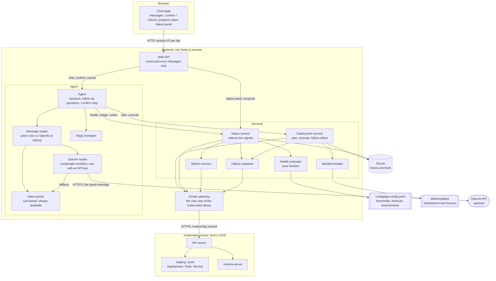
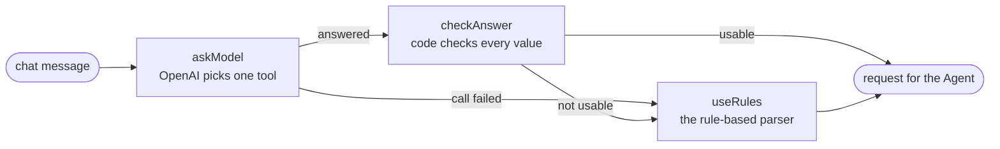

# Design

## 1. Architecture

Each layer calls only the layer below it. The browser never talks to Kubernetes. The routes contain no logic. One folder, `src/cluster/`, is the only place that imports the Kubernetes client library; the services see a small interface (`ClusterGateway`, in `src/types/cluster.ts`) with plain data types.

That one boundary pays for itself twice. The unit tests swap the gateway for an in-memory fake and run without a cluster, and a different cluster is just a different gateway.

Reading a chat message has the same kind of boundary. The Agent asks a message reader, and gets the same small request back whether the rules or OpenAI read the message. LangGraph is used in one file (`src/agent/openAiReader.ts`) and the OpenAI library in one file (`src/agent/openAiModel.ts`). Section 10 explains the two readers.

**Trade-off.** The gateway translates every Kubernetes object into a smaller type of my own. That is extra code, and a field I did not map is not available to the services until I add it. I accepted that because the services stay readable and testable.

## 2. Long operations

A rollout can take minutes, so the Confirm request does not wait for it.

1. `execute()` takes the lock, applies the manifests and returns an operation ID. This takes well under a second.
2. A loop keeps running in the background of the same Node.js process. Every 2 seconds it reads the Deployment and its pods and records progress such as `2/3 pods ready`.
3. The browser asks `GET /api/operations/:id` once a second and redraws the progress: the step the change is at (for example "Starting the pods, 2 of 3 ready") and a track with one square per pod, from "sent" to "finished".

Node.js stays responsive because every Kubernetes call is asynchronous: while one rollout waits, the process serves other requests.

**Why polling.** It is the simplest of the three options and works through any proxy. The progress is a few short strings, so a request per second costs almost nothing. The price is a delay of up to one second and some wasted requests. Server-Sent Events would push each step as it happens and is what I would move to with many users. WebSockets are for two-way traffic, which this does not need.

**Limit.** Progress lives in memory. If the backend restarts during a rollout, Kubernetes finishes the rollout anyway, but nobody is watching it. On the next start those history rows are marked `interrupted`, which also frees the environment's lock.

## 3. Two confirmations at the same moment

**In Kubernetes, with no protection.** Both updates are accepted one after the other. The Deployment controller starts rolling out the first image, then turns around and rolls out the second. The last write wins, and the first user believes their version is live.

**What the app does.** Three layers, strongest first:

1. **A lock in the database.** Starting a change inserts a row with status `in_progress`. A unique index allows one such row per environment of a cluster, so when two requests arrive together the database accepts exactly one. The other user reads: `staging already has a deployment in progress (dep-006, started by asha). Try again when it finishes.`
2. **A stale-summary check.** Before applying, the app compares the cluster with what the user saw in the confirmation. If someone else changed the environment in between, it refuses and asks them to ask again.
3. **The resource version.** A replace carries the version that was read. If the Deployment changed in between, Kubernetes answers 409 Conflict instead of overwriting.

**Trade-offs.** The lock is per environment, not per app, which is stricter than needed once there are many apps. It also lives in one SQLite file, so it only works with one backend instance. With several instances I would move it to a shared database or a Kubernetes Lease.

## 4. Security

**How the backend authenticates to EKS.**

- **kubeconfig** says where the cluster is and how to get a credential. For EKS it does not hold a password; it runs `aws eks get-token`.
- **AWS IAM** answers "who is calling". The token is a request signed with the assistant's IAM role, and EKS asks AWS to verify it.
- **An EKS access entry** maps that IAM role to a Kubernetes group, `deployment-assistant`.
- **Kubernetes RBAC** answers "what may they do". A RoleBinding in `staging` and `prod` gives the group a Role.

**The minimum Role**, in each of the two namespaces:

| Resource | Verbs | Used for |
|---|---|---|
| deployments | get, create, update | deploy, scale, roll back |
| services | get, create, update | the Service in front of the pods |
| services/proxy | get | the `/health` call |
| pods | list | pod states and restart counts |
| pods/log | get | last log lines of a crashing pod |
| events | list | why a pod is not ready |
| namespaces | get | telling "namespace missing" from "not deployed" |
| pods in `metrics.k8s.io` | list | CPU and memory |

Plus one read-only ClusterRole to list nodes and their usage, because nodes belong to no namespace. I tested these exact rules on kind with a restricted login: everything the app does works, and delete, Secrets and other namespaces are refused.

**Stopping a browser user from doing what they should not.**

- The browser can send only two things: a line of text, and the ID of an action the server created for that tab. It cannot name a Kubernetes operation.
- A change runs only through `confirm()`, with an ID that is bound to one session, works once and expires after ten minutes.
- Every value is checked on the server: the environment and app must be in the config file, the image version must match a strict pattern, and replicas have a maximum.
- When OpenAI reads the message, its answer is treated like the user's text: a proposal that goes through the same checks and the same Confirm step (section 10).
- The server listens on `127.0.0.1` only. Every request that can change something needs a custom header, so another website open in the same browser cannot make the browser send one.
- Whatever goes wrong in the app, RBAC still limits it to two namespaces.

**What is missing.** There is no login. The name in the top right corner is typed by the user and is not proof of who they are. For a shared installation I would add single sign-on and a rule such as "only release managers may confirm a change to prod".

## 5. The rollout completes but /health fails

**For rolling back automatically.** Recovery is fast and needs nobody awake. The previous version is known to have worked.

**Against.** A failing `/health` does not prove the new version is at fault: a database or another service may be down, and then rolling back changes nothing but hides the evidence. If the new version already changed a database schema, the old version may be worse. And a tool that changes production by itself, without being asked, is harder to trust.

**What I chose: no automatic rollback.** The assistant reports DOWN with the reason, and the user types `roll back staging` and confirms. That is one message and one click, with a person making the decision.

Two things make this safer than it sounds. The readiness probe also calls `/health`, so a version that fails it never becomes ready and the rollout does not complete. And the rollout uses `maxUnavailable: 0`, so the old pods keep serving until new ones are ready. I saw this with the broken `v3` image: the rollout failed and the app stayed up.

Automatic rollback is a reasonable opt-in for staging later. I would not make it the default for prod.

## 6. "What was CPU usage during the spike an hour ago?"

The metrics API holds only the latest value, so this needs something that stores history.

- **Prometheus** scrapes every container every few seconds and keeps the series. The question becomes one range query. Trade-off: one more system to run, secure and give storage.
- **CloudWatch Container Insights** on EKS does the same as a managed service. Trade-off: cost per metric, and it works only on AWS.

In the code this would be one more gateway method for a range query and one more intent. I would not record samples in SQLite myself: that is building a small, worse Prometheus.

## 7. Thresholds

| Threshold | Value | Why |
|---|---|---|
| Memory | 85% of limit | Memory cannot be slowed down. At 100% the container is killed, so the warning needs room. |
| CPU | 90% of limit | At the limit CPU is throttled, not killed, so the warning can come later. |
| Restarts | more than 3 | One restart can be bad luck. Several are a pattern. |
| Recent OOMKill | within 30 minutes | Long enough to notice, short enough to clear by itself. |
| `/health` response | slower than 1000 ms | A health check should answer in milliseconds. |
| Pending | longer than 60 seconds | Normal scheduling and image pulls finish well inside that. |

These are sensible starting points, not measured values. A real team would tune them against its own traffic.

**Per team.** The config file has `thresholds.overrides.<environment>`, so `prod` can be stricter than `staging` without touching code. To let each team set its own without a central file, I would read them from annotations on the team's Deployment or from a ConfigMap in its namespace.

## 8. 200 pods across 20 namespaces

**Fast.** Already in place: one LIST of pods and one LIST of metrics per app, never one call per pod; the health call and the metrics call run at the same time; only the first five failing pods are explained, because each explanation can cost two more calls.

What I would add: check namespaces in parallel with a limit on how many run at once; keep results for a few seconds so several users asking the same thing cost one round of calls; and for a busy installation, switch from asking on demand to watching, which keeps a local copy of the pods up to date.

**Readable.** Nobody reads 200 lines in a chat. Lead with one summary line, such as "20 environments: 17 healthy, 2 degraded, 1 down". Show details only for the ones that are not healthy, limit pod lists to the worst few with "and 12 more", and let the user ask for one environment in full.

## 9. A second cluster, or GKE

The agent and services depend on the `ClusterGateway` interface, not on a cluster.

- **GKE** speaks the same Kubernetes API. It is one more kubeconfig context, with Google's login plugin in place of `aws eks get-token`. No code changes.
- **Several clusters at once** needs one change: an environment would map to a context as well as a namespace in the config file, and the app would keep one gateway per context.
- **The history is already kept per cluster.** Every row stores the cluster's name from the kubeconfig. The list, the lock and roll back look only at the cluster the app is connected to, so pointing the app from kind to EKS cannot roll EKS back to an image that only ever ran on kind. It is the cluster's name and not the context's, because two contexts can be two logins for one cluster (the admin one and the assistant's limited one), and they must share one history.

What differs between clouds stays in settings: the image registry is already one. Terraform is separate for each cloud by nature; the app does not care which one built the cluster.

## 10. Rule-based parsing or an LLM

**I use both, and the rules are the base.** The rules always work: no network, no cost, no API key, the same answer every time, and every sentence in the test description is a unit test. Their weakness is that they are brittle: `push v2 out to staging` is not understood, because I wrote no rule for "push".

When `OPENAI_API_KEY` is set, an OpenAI model reads the messages instead and handles that kind of phrasing. Without a key the app starts normally and says that the LLM is not configured.

**How the LLM is used.** It is tool calling in which the tools do nothing by themselves. The model gets one message and a fixed list of eleven tools (`deploy`, `scale`, `roll_back`, `check_health` and so on) and must pick one and fill in its details. The pick is turned into the same small request the rules produce. From there the Agent code is the same in both modes: it asks for missing details, validates, and shows Confirm.

The steps are a LangGraph workflow with three nodes:

**Why LangGraph for three steps.** Plain code with a try/catch would also work at this size. With LangGraph the steps and the fallback path are named and can be drawn, and a further step (a second model, a retry with a different prompt) is one more node. The price is two more dependencies for a small graph.

**Risks of letting an LLM choose the action, and how each is limited.**

| Risk | Limit |
|---|---|
| It picks the wrong target, prod instead of staging | An environment counts only if the user wrote it in the message and the rule code reads the same one there. One typing mistake is forgiven in a name of six letters or more ("stagin"); a shorter name such as prod must be spelled right, because one letter off is often another word ("pod"). Otherwise it is dropped and the Agent asks. Every change shows the exact summary and needs Confirm; prod adds the warning. |
| It invents a value | A version must appear in the user's own text and is copied from there. App, environment and replicas go through the same server checks as typed input. |
| Text it reads steers it (prompt injection) | It reads only the typed message and, when the assistant has asked a question, the unfinished request. It never sees cluster output such as log lines. Whatever it is told, it can only pick from the list, and no tool on the list runs a command. |
| The same sentence gives different results | The rules stay the reference, and all their tests still run. For a change, Confirm shows what was understood before anything happens. |
| OpenAI is slow, down, or the key is wrong | One try with a timeout from the config file (8 seconds). On failure the rules read the message and the reply says so. OpenAI is not tried again for a minute, so the chat stays fast. |
| Messages leave the company, and each one costs money | Only the typed message and the environment and app names from the config file are sent, never cluster data. Nothing is sent unless a key is set. |

**What the model does not do.** It does not keep the conversation, decide what is missing, or confirm anything. That stays in the Agent, so a conversation carries on unchanged if OpenAI fails half-way through it.

**Trade-off I accepted.** The environment check makes the model less flexible: "push v2 live" does not become a deploy to prod; the assistant asks which environment. For the one value where a wrong guess does the most damage, I prefer the question.

---

# Terraform

## 1. Remote state and locking

The state file is Terraform's record of what it created. On a laptop it can be lost, and nobody else can use it. In S3 it is shared, encrypted and versioned.

Locking matters because a run reads the state, changes resources, and writes the state back. Without a lock, two people who apply at the same time both read the same state and both make changes. Whoever writes last overwrites the other's record. Terraform then no longer knows about resources that exist, and the next run tries to create them again, fails with "already exists", or leaves them running and billed. With the lock file, the second run stops at once with a message saying who holds the lock.

## 2. Someone changes the node count in the console

**Finding out.** `terraform plan` compares the state with what really exists and shows the difference. `terraform plan -refresh-only` shows only that. Running it on a schedule in CI catches drift early, and CloudTrail shows who made the change.

**What the next apply does.** It depends on which number.

- **Minimum or maximum:** Terraform sees the difference and sets it back to the value in the code.
- **Desired size:** nothing. The EKS module deliberately ignores changes to it, so that an autoscaler can add and remove nodes without Terraform undoing that on every apply.

So the code is the truth for the limits, and the running system is the truth for the current size.

## 3. Keeping staging and prod apart

| Approach | Good | Bad |
|---|---|---|
| **`.tfvars` files with separate state** (what I use) | One copy of the code. The differences are a short, readable file. Each environment has its own state. | Nothing stops you from pairing the staging values with the prod state by mistake. |
| **Workspaces** | Quick to switch. One backend block. | The current workspace is invisible in the code and easy to get wrong. Differences end up as `if workspace == "prod"` scattered through the code. |
| **A folder per environment** | Strongest separation. Each environment can even pin a different module version. | The wiring is duplicated, and the copies drift apart. |

I chose the first: one codebase, `envs/staging.tfvars` and `envs/prod.tfvars`, and a separate state key for each. A wrapper script that always passes the matching pair would close the gap in the "bad" column. For real production I would also put prod in its own AWS account, so that staging credentials cannot touch it at all.

## 4. Upgrading the Kubernetes version

1. **Read first.** EKS upgrades one minor version at a time and cannot go back. Check the release notes for removed APIs and make sure nothing we deploy uses them.
2. **Staging first.** Change `kubernetes_version`, run `plan`, read it, `apply`.
3. **What Terraform does.** The control plane is upgraded first; the API stays available. Then the managed node group is replaced node by node: each node is drained, its pods move, a new node joins. Add-ons move to versions that match.
4. **What keeps the app up.** More than one replica and readiness probes, which the assistant's template already sets. A PodDisruptionBudget, so a drain never takes the last pod, is the missing piece: the template does not create one yet.
5. **Check.** `full status of staging`, and `plan` again to see no changes.
6. **Then prod**, the same way, at a quiet time.

Because there is no way back for the control plane, the staging run is the real test.

## 5. How the assistant reaches only its namespaces

The IAM role carries no Kubernetes power by itself. An access entry maps it to a group, and no EKS access policy is attached to that entry. The group's permissions come only from RoleBindings, and those exist only in `staging` and `prod`. In every other namespace nothing grants the group anything, so Kubernetes refuses.

**Why not cluster-admin.** It would work and take less effort, which is why it is tempting. But the assistant accepts text from users and holds credentials, so it is exactly the kind of program that should be assumed to fail one day. With cluster-admin, a bug or a leaked credential can read every Secret and delete every workload. With this Role, it can replace a Deployment in two namespaces. It cannot even delete one.

---

# Known limits

- **One backend instance.** Sessions and progress are in memory, and the lock is a local SQLite file.
- **No login.** The requester's name is whatever was typed, so it is stored as plain text on each deployment. The next step is a login together with a `users` table: name, email, kind (a person, a service such as a CI job, or the system itself), role (viewer, deployer, admin: who may deploy to prod), and when they were first and last seen. `requested_by` then becomes a reference to a user. I left the table out until there is a login, because without one it would only hold unchecked names in a second place.
- **Without an OpenAI key**, parsing is rule-based and understands the phrasings I wrote rules for.
- **With a key**, every typed message is sent to OpenAI. The automated tests use pretend model answers; with a real key I checked it by hand on a dozen messages.
- **Roll back** restores the image that ran before the last change, so rolling back twice returns to where you started, like `kubectl rollout undo`.
- **Bonus features** from the test are not built.
